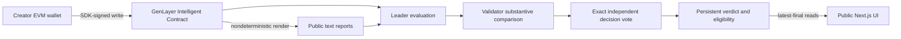

# Architecture

## Trust boundaries

The frontend validates and serializes input, requests wallet signatures using the official SDK, and displays chain records. It cannot assign a verdict or override contract state. There is no backend adjudicator. The injected EVM provider is used for account/network permissions; `genlayer-js` performs contract writes.

The contract owns authorization, bounded storage, criteria, evidence, evaluation, and eligibility. Projects use `TreeMap[str,str]` JSON records and a `u32` counter. Numeric targets in JSON are bounded, finite nonnegative numbers; target must exceed baseline. Persistent counters never use bare Python `int`.

## State machine

`AWAITING_EVIDENCE → READY_FOR_VERIFICATION → APPROVED | REJECTED | NEEDS_REVIEW`

Transaction lifecycle is separate: signing → pending submission → consensus → finalized successful execution. Cancellation and execution errors are failures. A submitted/accepted transaction is insufficient to claim finality. RPC failure or timeout pauses monitoring and retains the same hash. Resume checks that transaction rather than submitting it again.

Criteria cannot be edited. Evidence cannot be overwritten. Every terminal verdict is immutable, with at most one evaluation result per milestone. Failed consensus has no committed verdict and can be retried after checking the failed transaction.

## Evaluation

Copy storage into plain data before entering nondeterministic closures. For each public HTTPS source, render text, hash the complete returned text, and send at most its first 16,000 characters to evaluation. Any failed/empty retrieval yields NEEDS_REVIEW. Successful retrieval is not credibility.

The prompt separates untrusted data from evaluation instructions and requires specific relevant support for each criterion. Outputs have validated bounded decision, reason, and limitations. Validator comparison requires the same decision plus substantively equivalent evidence analysis. A second independent evaluation reaches strict consensus on its enum. The deterministic outer code requires agreement with the comparative result. Different enum results cannot silently persist.

This double evaluation is conservative and incurs extra retrieval and LLM work. Mutable sources or model variance can cause no consensus. Direct-mode mocks do not establish realistic liveness or cost; profile through Studio after deployment.

## Record integrity

The submission hash covers canonical, sorted JSON containing URLs, explanation, submitter, and transaction chain time. Source SHA-256 identifies the returned text at evaluation time. It is neither an independent attestation nor a URL content guarantee. Verdicts store methodology version, evaluation chain time, project/milestone IDs, and eligibility. Transaction hashes are available through client receipts and Studio; the pinned contract message does not expose a supported transaction-hash field.

## Funding

Only a contract-generated APPROVED result sets `funding_eligible=true`. There is no method to set eligibility directly, deposit, withdraw, or transfer assets. Allocation fields are administrative references. Financial disbursement and escrow remain out of scope.
